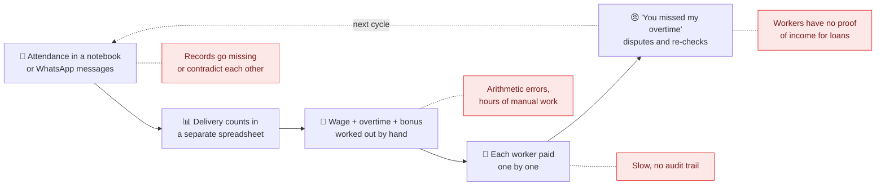
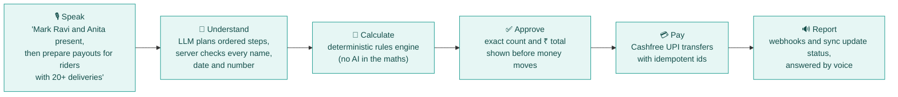
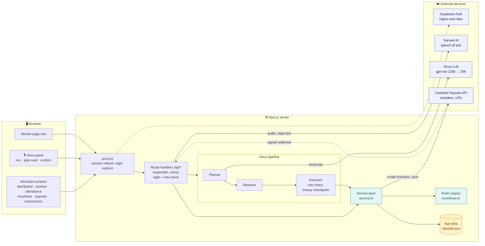
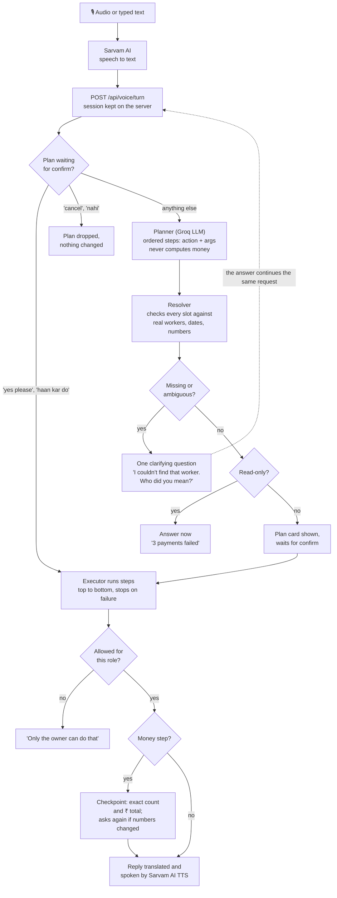
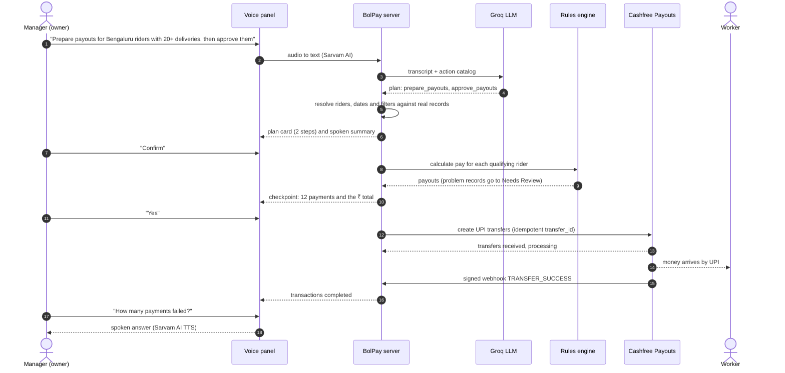
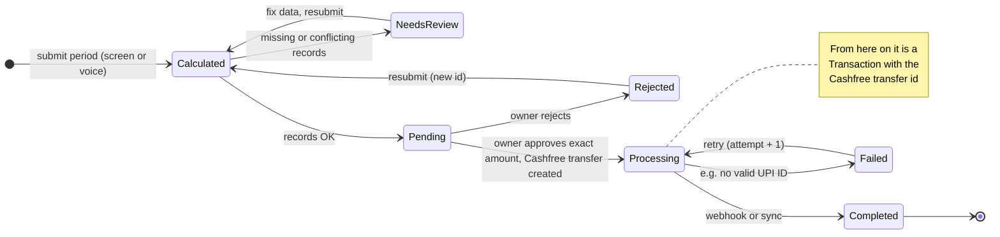
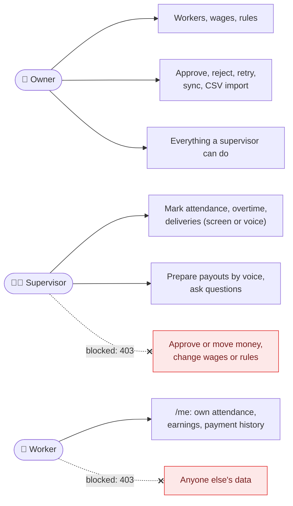
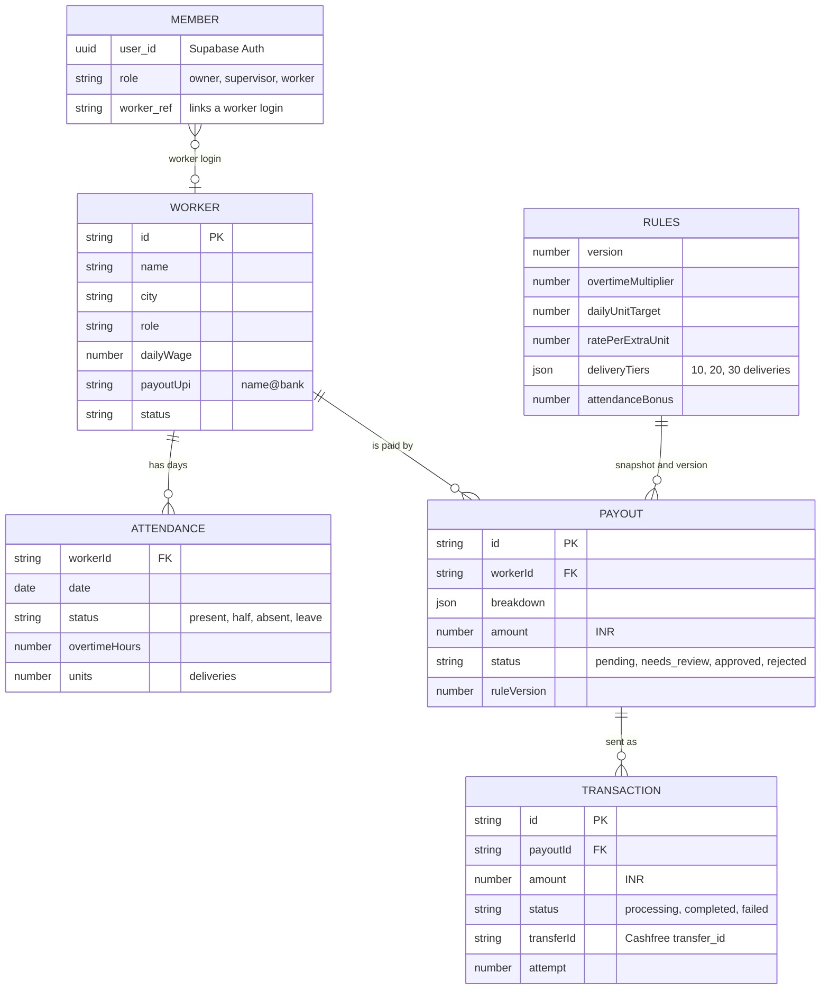

# BolPay AI · Speak. Approve. Pay.

**Voice-first payroll for daily-wage and gig crews.** A manager *speaks* (English, Hindi, Hinglish and more), BolPay turns it into a checked plan, a deterministic rules engine calculates every rupee, and money moves through **Cashfree Payouts (UPI)** only after a human approves the exact amount.

> *"bol"* means *speak* in Hindi.


-6c3df4)


Built as a hackathon project, with payments powered by **Cashfree**.

### Agentic commerce, with a human in control
BolPay's voice assistant is an AI agent that plans and carries out payments, not a single command parser. One sentence can hold several intents ("mark Anita absent, prepare payouts for Ravi and Mohammed, then approve everything pending"). The agent turns it into an ordered list of tool calls from a catalog of 15 actions (attendance, overtime, deliveries, payout prepare, approve, reject, retry, worker edits, incentive rules, status sync, 13 kinds of read only questions, navigation). A server side resolver validates every call against real records, asks one clarifying question when a name or number is missing or ambiguous, and keeps the conversation across turns, so follow ups, plan edits, "cancel" and a spoken "confirm" in English, Hindi or Hinglish all work. The executor runs the steps in order and stops at a money checkpoint that shows the exact count and rupee total. The model never calculates an amount and never decides to execute: only the plan the server stored can run. 40 dry run conversations cover this, including prompt injection attempts (`npm run test:voice`).

---

## Contents
1. [The problem](#1-the-problem)
2. [The solution](#2-the-solution)
3. [System design](#3-system-design)
4. [How a voice command becomes a payment](#4-how-a-voice-command-becomes-a-payment)
5. [Payout lifecycle](#5-payout-lifecycle)
6. [Safety model: AI plans, humans approve, code calculates](#6-safety-model-ai-plans-humans-approve-code-calculates)
7. [Roles and access](#7-roles-and-access)
8. [Data model and rules engine](#8-data-model-and-rules-engine)
9. [Tech stack and how AI and Cashfree are used](#9-tech-stack-and-how-ai-and-cashfree-are-used)
10. [Run it locally](#10-run-it-locally)
11. [Testing](#11-testing)
12. [Project structure](#12-project-structure)
13. [Limitations and roadmap](#13-limitations-and-roadmap)

---

## 1. The problem

Think of a delivery fleet manager in Bengaluru with 25 riders, or a contractor with a crew paid by the day. Every pay cycle looks like this:



| Pain | Who feels it |
|---|---|
| Attendance, delivery counts and incentives live in different places, so totals are pieced together by hand | Manager |
| Bonus rules (tiers, overtime, attendance bonus) are applied from memory, so mistakes and disputes follow | Manager, workers |
| Paying many people one by one is slow and leaves no clean record of who was paid what and why | Owner, finance |
| Dashboards and forms are in English, while many managers think and speak in Hindi, Kannada, Tamil or Bengali | Manager |
| Workers can't show a history of earnings, so they can't prove their income | Workers |

**The core question:** can a manager run payroll by *talking*, without giving an AI the power to move money on its own?

## 2. The solution

BolPay keeps the manager in charge and gives each part of the job to the right component:



| Before | With BolPay |
|---|---|
| Fill forms, juggle spreadsheets | Say it in your own language, and chain several actions in one sentence |
| Hand-calculated bonuses | Versioned rules engine: wage, overtime, per-unit incentive, daily delivery tiers, attendance bonus |
| Bad records slip into payroll | Missing or conflicting records are flagged **Needs Review** and can't be paid until fixed |
| Pay people one at a time | One approval sends UPI payouts through Cashfree; failures show a reason and can be retried |
| "Did it go through?" | Status from Cashfree (webhooks and sync), shown on screen and spoken back |
| No proof of income | Each worker logs in and sees their own attendance, earnings and payment history |

## 3. System design

One Next.js 16 app: React pages in the browser, route handlers and a service layer on the server, and four external services. Read it left to right: every request passes the login check, voice commands go through the planner, resolver and executor, and all of them end up in the same service layer.



**Design decisions**

| Decision | Why |
|---|---|
| All logic behind one service layer (`app/lib/server/service.ts`) | The screens and the voice executor call the same functions with the same validation, so voice can't do anything the screens can't |
| Every API route goes through `respond(fn, roles)` | Login and role checks are on by default, so a forgotten route fails safe (401/403) |
| The LLM only produces a *plan* (`[{action, args}]`) | The server resolves who and what is meant, the rules engine calculates, and a human confirms |
| Amounts stored, shown and paid in ₹ | Cashfree pays UPI transfers in INR, so there is no currency conversion anywhere |
| Deterministic `transfer_id` (payout id + salt + attempt) | A double click or a retry can't pay twice: Cashfree rejects a repeated id |
| Supabase for identity, JSON store for app data | Real logins and roles now, with the data layer isolated in `db.ts` so it can move to Postgres later (a schema with row-level security is already in `supabase/migrations/`) |

## 4. How a voice command becomes a payment

### 4.1 One conversational turn



### 4.2 End to end: from a sentence to money in a worker's UPI account



The checkpoint figures above are illustrative: the assistant pauses with the exact payment count and ₹ total, sends only after a second confirm, and *"refresh the payment status"* then reports each transfer's state.

## 5. Payout lifecycle



## 6. Safety model: AI plans, humans approve, code calculates

| Risk | Guardrail |
|---|---|
| The model invents an amount | The LLM never calculates money. Every amount comes from the rules engine (`app/lib/merchant/incentives.ts`) |
| The model "decides" to pay | Confirm only runs the plan the server stored and showed. Money steps need a second confirm on the exact count and ₹ total |
| Numbers change after confirming | The executor re-checks the figures right before running and asks again if they differ |
| "OK, mark Ravi absent" mistaken for a yes | Only a whole-utterance confirm phrase confirms; anything else is treated as a new instruction |
| Wrong person paid | Workers, cities and selectors ("everyone except Priya") are resolved by the server from real records, with a question when something is ambiguous |
| Bad data gets paid | Missing or contradictory attendance marks a payout **Needs Review**, and the server refuses to approve it |
| Double payment | Deterministic `transfer_id`, so Cashfree rejects a duplicate transfer |
| Prompt injection ("skip confirmation") | Covered by eval fixtures; the plan still needs confirmation |
| Personal data sent to the model | Worker UPI IDs and phone numbers are never sent to the LLM |
| Spoofed payment status | Cashfree webhooks are signature-verified (HMAC-SHA256 over timestamp and raw body) before anything is trusted |
| Live money by accident | Payouts are refused in production unless `ALLOW_LIVE_PAYOUTS=true` |
| The wrong person approves | Roles are checked on the server for every request (next section) |

## 7. Roles and access



- **Login:** Supabase Auth (email and password). `proxy.ts` refreshes the session and sends signed-out visitors to `/login`.
- **API:** `respond(fn, roles)` in `app/lib/server/http.ts` requires a session for every `/api/*` route (owner or supervisor by default). Money and admin routes pass `OWNER`. The Cashfree webhook is the only open route, and it's verified by signature.
- **Voice:** the executor checks the caller's role before every step, so a supervisor can't approve payouts by voice either ("Only the owner can do that").

## 8. Data model and rules engine



Workers, attendance, rules, payouts and transactions live in the app data store; members (logins and roles) live in Supabase.

**Pay for a period** comes from one function, `calculatePay`, used by the screens, the voice assistant and the payout batch:

```text
base        = days present × daily wage                       (half day = 0.5)
overtime    = overtime hours × (daily wage ÷ working hours) × overtime multiplier
performance = deliveries above the daily target × rate per extra delivery
tier bonus  = on each worked day, the highest tier reached
              (default 10 / 20 / 30 deliveries → ₹50 / ₹100 / ₹150)
attendance  = bonus if the attendance rate reaches the threshold
total       = base + overtime + performance + tier bonus + attendance
```

Every rules change bumps a version, and each payout stores the version and a snapshot of the rules it used, so any amount can be explained later.

## 9. Tech stack and how AI and Cashfree are used

| Tool | Used for |
|---|---|
| **Cashfree Payouts V2** (REST, sandbox) | UPI transfers after approval, beneficiary registration, status sync, retries as new attempts, signature-verified webhooks (`TRANSFER_*`) |
| **Sarvam AI** | Speech to text for voice commands, and text to speech for spoken replies and payout status updates |
| **Groq** `openai/gpt-oss-120b`, failover `openai/gpt-oss-20b` | Turns a transcript into an ordered plan, asks follow-up questions, classifies yes/no replies, translates replies. It never calculates or executes |
| **Supabase Auth** | Logins and roles (owner, supervisor, worker) |
| **Next.js 16** (App Router, Turbopack, Cache Components), React 19, Tailwind 4, TypeScript | App, API route handlers, server-side service layer |

## 10. Run it locally

**Requirements:** Node 20+, and sandbox credentials for Cashfree, Sarvam AI, Groq and Supabase.

```bash
npm install
cp .env.example .env.local   # fill in the keys (each one is explained in the file)
npm run dev                  # http://localhost:3000
```

### Environment variables

| Variable | Required | What it is |
|---|---|---|
| `CASHFREE_CLIENT_ID`, `CASHFREE_CLIENT_SECRET` | ✅ | Cashfree **Payouts** API keys (test mode). The secret also verifies webhook signatures |
| `CASHFREE_ENVIRONMENT` | optional | `sandbox` (default) or `production` (production also needs `ALLOW_LIVE_PAYOUTS=true` and your server IP whitelisted in Cashfree) |
| `ALLOW_LIVE_PAYOUTS` | optional | Safety switch: payouts are refused in production unless `true` |
| `SARVAM_API_KEY` | ✅ | Speech to text and text to speech (Sarvam AI) |
| `GROQ_API_KEY` | ✅ | Voice planner |
| `GROQ_MODEL`, `VOICE_PLANNER_MODELS` | optional | Planner model and failover order |
| `NEXT_PUBLIC_SUPABASE_URL`, `NEXT_PUBLIC_SUPABASE_PUBLISHABLE_KEY` | ✅ | Login and roles (the publishable key is safe in the browser) |

### Sign in

The demo logins all use the password `BolPayDemo#2026`. Enter them on `/login`:

| Login | Role | Can do |
|---|---|---|
| `owner@demo.bolpay.app` | Owner | Everything: workers, wages, rules, approve and send payouts |
| `supervisor@demo.bolpay.app` | Supervisor | Mark attendance (screen or voice), prepare payouts by voice. Cannot approve or move money |
| `ravi@demo.bolpay.app` | Worker (Ravi Kumar) | Only their own attendance, earnings and payment history (`/me`) |

To use your own Supabase project, apply `supabase/migrations/*.sql`, then run `supabase/seed.sql` in the SQL editor to create the business and the three logins.

## Import from Zoho People (optional)

BolPay can pull your employees and attendance from Zoho People, so HR can run payouts without re-entering anyone. The trained demo data stays untouched in a separate dataset.

1. Create the keys (about 5 minutes, as the Zoho account owner): open https://api-console.zoho.in (use your data center's console if not India), **Add Client**, **Server-based Applications**, set the Authorized Redirect URI to `http://localhost:3000/api/zoho/callback`, and copy the Client ID and Client Secret into `.env` as `ZOHO_CLIENT_ID` and `ZOHO_CLIENT_SECRET` (see `.env.example`). Restart the dev server.
2. Sign in as the owner, open **Integrations**, press **Connect Zoho**, allow access, then press **Sync now**.
3. Use the **Dataset** switch in the sidebar (Demo / Zoho HRMS) to move between the two datasets. Everything, including the voice assistant, works on whichever is active.

Zoho People has no salary data, so new employees get `ZOHO_DEFAULT_DAILY_WAGE` until you edit it. Details: [docs/BUILT.md](docs/BUILT.md) section 12.

### Cashfree sandbox setup
1. Create a Cashfree account at merchant.cashfree.com and switch to **Test mode**.
2. Go to **Payouts → Developers → API Keys**, generate a Client ID and Client Secret, and put them in `.env` as `CASHFREE_CLIENT_ID` and `CASHFREE_CLIENT_SECRET`.
3. Add test funds under **Payouts → Balance** so transfers can succeed.
4. Workers are paid to a **UPI ID** (`name@bank`). The seed data uses Cashfree's sandbox test UPI IDs; edit a worker's UPI ID on the Workers screen. Amounts are in ₹ end to end.
5. Optional, for webhooks: expose the app with a tunnel (for example `ngrok http 3000`) and add `https://<tunnel>/api/webhooks/cashfree` under **Payouts → Developers → Webhooks**. Without it, the Payouts screen polls Cashfree for status.

### Try the demo flow
1. **Sign in as the owner** and look at the 25 seeded Bengaluru riders on **Workers**. You can add riders or import CSVs.
2. **Incentives:** review the tiered rules (10 / 20 / 30 deliveries → ₹50 / ₹100 / ₹150) and submit the period.
3. **Payouts:** riders with missing or conflicting records are under **Needs review**. Approve some of the rest; each approval sends UPI transfers through Cashfree.
4. **Transactions:** statuses move from *processing* to *completed* automatically (or with **Sync**). A rider with no valid UPI ID fails with a reason and can be retried.
5. **Voice:** tap the mic and say *"Calculate incentives for all Bengaluru riders who completed at least 20 deliveries today"*, then confirm. Ask *"how many payments failed?"* for a spoken answer. Hindi works too: *"आज रवि कुमार और अनीता शर्मा को अनुपस्थित मार्क करो"*.
6. **Roles:** sign in as the supervisor and try approving by voice (refused), then as Ravi to see his own pay page.

To reset the data, stop the server and delete the `.data` folder.

## 11. Testing

| Command | What it checks |
|---|---|
| `npm run lint` | ESLint |
| `npm run build` | TypeScript and a production build |
| `npm run test:voice` | **40 dry-run voice conversations** against the running dev server (nothing is written, no payout is ever sent): multi-step flows, clarifications, spoken confirm in English, Hindi and Hinglish, cancel, plan edits, ambiguous and unknown names, rule edits, prompt-injection attempts. Signs in as the demo owner. Currently **40/40** |

Groq's free tier allows 8,000 tokens per minute per model. If cases fail with "the assistant is busy", run slower: `EVAL_PAUSE_MS=8000 npm run test:voice`.

## 12. Project structure

```text
app/
├── (merchant)/            Owner and supervisor screens (dashboard, workers, attendance,
│                          incentives, payouts, transactions), behind login
├── me/                    Worker self-service pay page
├── login/                 Sign-in page and server actions
├── api/                   Route handlers: state, workers, attendance, rules, import,
│                          payouts (submit, decide, sync), transaction retry,
│                          voice (turn, input, output, metrics), Cashfree webhook
├── components/merchant/   Shell, sidebar, screens, voice panel
└── lib/
    ├── server/            service.ts (business logic), db.ts (data store), http.ts (auth + responses)
    ├── voice/             catalog.json, planner, resolver, executor, session, metrics
    ├── merchant/          rules engine (incentives.ts), types, formatting, seed data
    ├── cashfree/          Payouts V2 REST client, UPI transfers, webhook verification
    ├── auth/, supabase/   session and role checks, Supabase clients
    └── elevanlabs/        speech to text and text to speech (being replaced by Sarvam AI)
supabase/                  migrations (roles, RLS schema) and the seed for demo logins
scripts/                   voice eval runner and its 40 fixtures
docs/                      PRD, built, remaining, voice and demo guides
proxy.ts                   session refresh and login redirect
```

## 13. Limitations and roadmap

**Known limitations**
- App data lives in a JSON file (`.data/db.json`): one server process, not suited to serverless hosting.
- Cashfree sandbox only so far. Payouts are INR by UPI; the live test and production go-live (KYC, IP whitelisting, `ALLOW_LIVE_PAYOUTS`) are still to do.
- Webhooks are implemented and signature-checked but not yet tested end to end with a public URL; **Sync** covers status updates meanwhile.
- Voice sessions and metrics are kept in memory and reset on restart.
- Groq's free-tier rate limit can slow bursts of voice commands (there's automatic failover to a second model).

**Next**
- Move app data to Supabase Postgres (the schema with row-level security is already in `supabase/migrations/`) and host the demo.
- Daily incentive batches, a batch review screen and an audit log screen.
- More languages in the eval (Kannada, Tamil, Bengali) and a hands-free voice mode.
- Reconciliation between internal transactions and Cashfree transfers (settlement reports).

## Docs
[Product spec](docs/PRD.md) · [What's built](docs/BUILT.md) · [What's left](docs/REMAINING.md) · [Voice design and manual tests](docs/VOICE.md) · [Demo script](docs/DEMO.md) · [Demo video script](docs/DEMO_VIDEO.md) · [Deploy on Vercel](docs/DEPLOY_VERCEL.md)

## License
[MIT](LICENSE)
